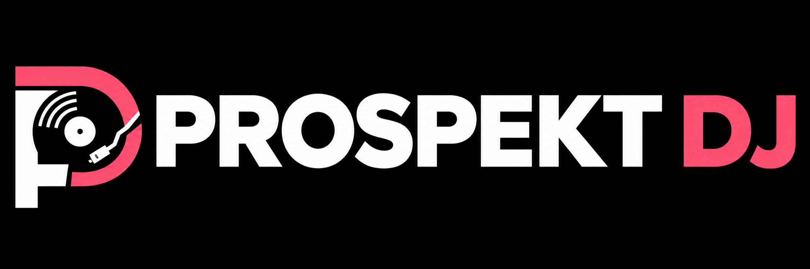
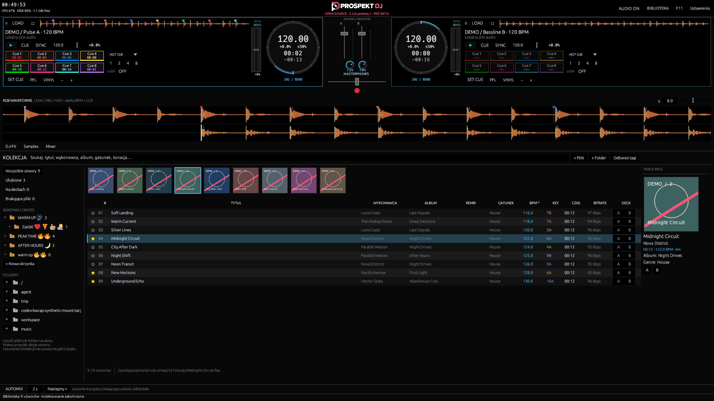
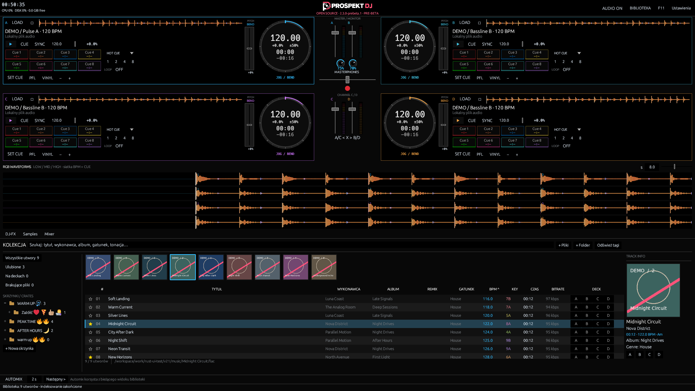
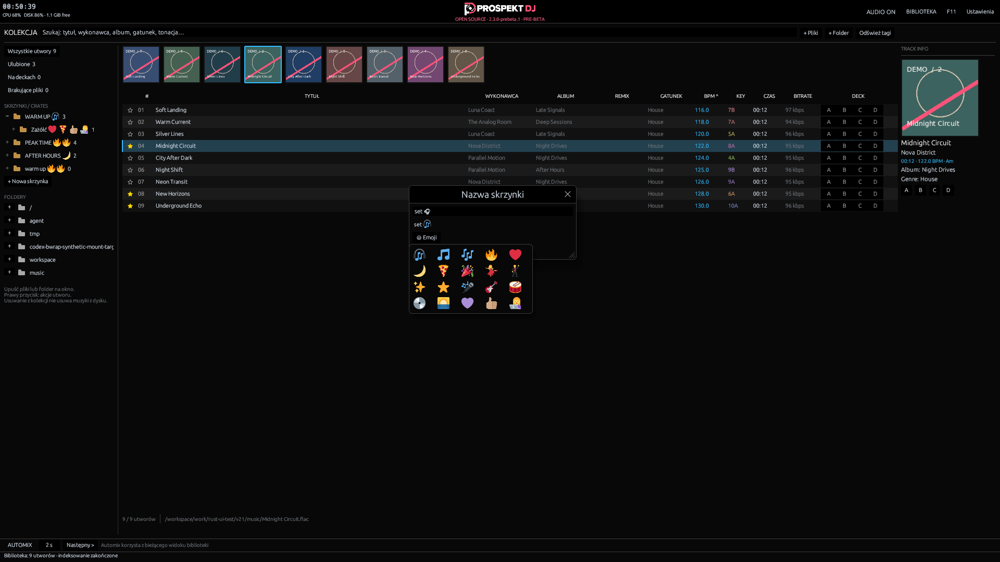

# Prospekt DJ — Rust Edition 2.3 PRE-BETA

<p align="center"></p>

[Polski](#polski) | [English](#english)

## Polski

**PRE-BETA — wczesna wersja rozwojowa, przed etapem beta.** Funkcje i zgodność sprzętowa są nadal sprawdzane. To wydanie nie jest oznaczone jako stabilne.

**100% własnego kodu aplikacji i testów jest w Rust.** Nie jest to deklaracja, że wszystkie sterowniki systemowe i zewnętrzne kodeki są napisane w Rust. Biblioteki systemowe audio/okien oraz opcjonalny FFmpeg pozostają zewnętrznymi zależnościami.

Licencja projektu: **AGPL-3.0-or-later**. Źródła, Cargo.lock i instrukcje budowania znajdują się w paczce źródłowej. Licencje bibliotek są w `licenses/`, a ich lista w `docs/DEPENDENCIES.md`.

## Zrzuty ekranu — 2.3 PRE-BETA

Zrzuty z 18 listopada 2026 wykonano z rzeczywistej kompilacji Linux Release **2.3.0-prebeta.1**. [Dane kompilacji](docs/screenshots/build-info.json). Demonstracyjne audio i własne testowe okładki. Grafika nie pochodzi z komercyjnych programów DJ.







## Nowości w 2.3 PRE-BETA

- Większe ciemne jogi z BPM, tempem i czasami utworu oraz animowaną obręczą zgodną z pozycją nagrania. Pionowy, chwilowy PITCH BEND przy każdym jogu; większe suwaki kanałów i crossfadera. Kompaktowy układ: małe pady po bokach, jogi przy mikserze, przebiegi nad dużą biblioteką i boczny podgląd utworu.
- Osiem padów Hot Cue w układzie 2×4, wspólna paleta kolorów i klikalne znaczniki na obu przebiegach.
- Zagnieżdżone skrzynki, zmiana nazw, wybór emoji i rozwijane drzewo rzeczywistych folderów, ładowane w tle. Nazwy Unicode pozostają zachowane; 3846 kolorowych grafik Twemoji działa offline, także dla obsługiwanych sekwencji ZWJ i odcieni skóry. Licencja grafik: CC BY 4.0; podgląd koloru jest dostępny również w edytorze nazwy.
- Wirtualizowany pasek okładek zsynchronizowany z tabelą. Automatyczne, ostrożne dopasowanie przez MusicBrainz / Cover Art Archive, pamięć offline i ręczny wybór/odrzucenie grafiki.
- **Pobieranie okładek jest domyślnie włączone.** Wysyłane są publiczne metadane wykonawcy, albumu i tytułu; audio i prywatne ścieżki pozostają lokalne. Opcję można wyłączyć w ustawieniach ogólnych. Tagi plików nie są zmieniane.
- Grafitowe naprzemienne wiersze, pełne zaznaczenie, gatunek/wersja utworu i kolory rzeczywistych tonacji z tagów, opcjonalnie w Camelot.

[Szczegóły aktualizacji, obsługa i ograniczenia (English)](docs/UPDATE-2.3.md). W małym oknie panel wykonawczy można przewijać i zmieniać jego wysokość; kolumny biblioteki przewijają się poziomo.

## Nowości w 2.2 PRE-BETA

- Czarne tła paneli, wyśrodkowane logo PROSPEKT DJ, lokalny zegar oraz rzeczywiste wskaźniki CPU i zajętości dysku.
- Przełącznik 2/4 decków w ustawieniach. Każdy deck ma 8 hot cue; F1–F8 obsługują aktywny deck. Crossfader łączy A/C z B/D; automix używa A/B.
- Osiem efektów: filtr LPF/HPF, echo, reverb, flanger, chorus, tremolo, distortion i bitcrusher.
- Ustawienia ogólne, audio/nagrywanie, MIDI, automix, sterowanie i informacje o programie. Jasny motyw jest dostępny wyłącznie w ustawieniach.
- Wybór języka podstawowych kontrolek interfejsu: polski, angielski, chiński, hindi, hiszpański, arabski, francuski, portugalski, rosyjski i bengalski. Część opisów technicznych i diagnostyki pozostaje po polsku lub angielsku.
- 334 profile kontrolerów z dostarczonej paczki, wyszukiwanie producenta/modelu i import JSON/XML/OpenDJ. 289 profili zawiera rozpoznane przypisania MIDI; zakres zgodności i pominięte funkcje są pokazane w ustawieniach. To nie jest deklaracja pełnego testu sprzętowego.
- Linki GitHub, oznaczenie open source oraz teksty dołączonych licencji dostępne również offline w ustawieniach.
- Nowe wydanie z katalogiem mapowań jest **AGPL-3.0-or-later**; wcześniejsze wydania zachowują dotychczasową licencję. Pochodzenie i licencje mapowań: [informacje o mapowaniach](licenses/controller-mappings/README.md).

**Logo:** domyślnie używana jest nowa grafika w kolorze różowo-grejpfrutowym. Po wyłączeniu opcji „Logo graficzne” można użyć lokalnego, legalnie posiadanego fontu Helvetica Neue 95 Black. Font nie jest dołączany do paczek; tekstowy tryb logo ma otwarty zamiennik DejaVu Sans Bold.

## Zmiany w 2.1 (PRE-BETA)

- Kompaktowe decki, białe talerze, dwie fale RGB z pasmami rzeczywistego sygnału i zakładki DJ-FX / Samples / Mixer. W wąskim oknie talerze ustępują miejsca kontrolkom.
- Cztery efekty na deck: filtr LPF/HPF, echo z synchronizacją BPM, reverb i flanger; bypass i sterowanie MIDI.
- Proste pokrętła z resetem podwójnym kliknięciem i cienkie suwaki. Wyśrodkowany panel master/monitor; czerwona ikona nagrywania pod crossfaderem, kwadrat zatrzymania podczas nagrywania.
- Biblioteka z indeksowaniem w tle, pamięcią metadanych, skrzynkami, sortowaniem, wyszukiwaniem wielu słów i naprawą ścieżek brakujących plików. Usunięcie z katalogu nie usuwa pliku z dysku.

## Gotowe paczki

Paczki PRE-BETA: Windows x64 (ZIP), Linux x64 (tar.gz, AppImage, Flatpak) i Debian/Ubuntu amd64 (.deb) są publikowane w [GitHub Releases](https://github.com/prospektdj/prospektdj/releases). Sumy kontrolne są w SHA256SUMS.txt. Workflow buduje Windows i Linux, sprawdza archiwa i publikuje pięć paczek po zakończeniu obu zadań.

Instalacja DEB na Ubuntu 22.04+ lub Debian 12+: `sudo apt install ./prospekt-dj_2.3.0-prebeta.1_amd64.deb`. Program pojawi się w menu aplikacji; można też uruchomić `prospekt-dj` w terminalu. Usunięcie: `sudo apt remove prospekt-dj`. Ustawienia w katalogu użytkownika pozostają zachowane. FFmpeg jest zalecany dla dodatkowych formatów nagrywania.

### AppImage i Flatpak — PRE-BETA

AppImage: nadaj plikowi prawa wykonywania (`chmod +x Prospekt-DJ-Rust-*.AppImage`) i uruchom go. Można użyć `APPIMAGE_EXTRACT_AND_RUN=1 ./Prospekt-DJ-Rust-…AppImage`, jeśli system nie ma FUSE.

Flatpak: `flatpak install --user ./Prospekt-DJ-Rust-*.flatpak`, następnie `flatpak run org.prospektdj.ProspektDJ`. Runtime jest pobierany z Flathub. Katalog Muzyka jest dostępny bezpośrednio; inne pliki wybiera się przez portal. Dostęp do urządzeń umożliwia ALSA/MIDI. Dostęp sieciowy służy pobieraniu okładek. WAV i AIFF są natywne; pozostałe formaty wymagają wykonywalnego FFmpeg dostępnego wewnątrz środowiska aplikacji.

## Uruchamianie

Windows 10/11 x64: rozpakuj archiwum i uruchom `prospekt-dj.exe`. Nie wymaga Node.js, przeglądarki ani instalowania Rusta. Program nie jest podpisany cyfrowo.

Linux x64 z pulpitem: paczki z GitHub Releases są budowane na Ubuntu 22.04 i wymagają glibc 2.35+ (np. Ubuntu 22.04+ lub Debian 12+). Rozpakuj archiwum i uruchom `./prospekt-dj`. Wymagane są ALSA, X11/XWayland i sterownik OpenGL 3.3 lub zgodny Mesa. Systemowy wybór plików używa XDG Desktop Portal. Na Debianie/Ubuntu potrzebne biblioteki zwykle zapewniają pakiety `libasound2` (w nowszych wydaniach `libasound2t64`), `libx11-6`, `libxkbcommon0`, `libxkbcommon-x11-0`, `libgl1`, `xdg-desktop-portal` i backend portalu odpowiedni dla pulpitu.

Naciśnij **Demo 120 BPM**, następnie uruchom deck A/B. Parametr `--demo` wczytuje demo przy starcie. Pliki lub folder można przeciągać na okno; przy utworze przyciski A/B ładują odpowiedni deck.

Gdy brak działającego urządzenia audio, program wyświetla ten stan i pozwala wybrać inne wyjście w ustawieniach. Nie symuluje wówczas dźwięku. Zastosowanie nowego wyjścia wymaga pauzy decków i zakończenia nagrywania; utwory, punkty i sample pozostają w sesji.

## Funkcje

- Dwa lub cztery decki, odtwarzanie i pauza, przewijanie, aktualny/pozostały czas, waveform ogólny i przewijany z zoomem.
- Dekodowanie MP3, WAV, FLAC, Vorbis/OGG, AAC/M4A, ALAC i AIFF przez Symphonia. Nierozpoznany kodek, m.in. Opus, może skorzystać z FFmpeg. Obsługa metadanych i okładek przez Lofty.
- Tempo 50–150%, TAP, analiza BPM w tle, ręczne BPM, ×2/÷2, SYNC tempa i chwilowy pitch bend.
- Jog myszą i MIDI, scratch w obu kierunkach, CUE, osiem hot cue na deck, pętle 1/2/4/8 beatów i manual IN/OUT.
- Trzypasmowy EQ, głośności kanałów/master, crossfader stałej mocy, limiter i wskaźnik sygnału.
- Cztery współdzielone sample: plik lub fragment decka, odtwarzanie bez załadowanego decka, usuwanie i głośność.
- Biblioteka plików i folderów, wyszukiwanie, załadowane utwory, ulubione i obsługa upuszczania plików. Biblioteka jest teraz zachowywana między sesjami.
- Automix z przygotowaniem następnego utworu w tle, przejściem liczonym według próbek audio, wyborem ulubionych, losowaniem, powtarzaniem i dwiema krzywymi. Ręczny transport zatrzymuje automat.
- Natywne MIDI przez midir: Learn, Note/CC, kontrolki absolutne, trzy kodowania względnych enkoderów, import/eksport map JSON. Importuje także mapy poprzedniej wersji HTML.
- Osobne urządzenie MASTER i odsłuch PFL, niezależna głośność słuchawek i dopasowanie częstotliwości próbkowania osobnych wyjść.
- Zapis miksu po limiterze: WAV, AIFF, MP3, FLAC, OGG/Opus i OPUS. Dane płyną na dysk z osobnego wątku; nagranie nie jest przechowywane w całości w RAM.
- Jasny/ciemny motyw, pełny ekran, widok biblioteki, skróty i ustawienia. Zamknięcie podczas nagrywania pozwala najpierw dokończyć zapis.

## Nagrywanie i FFmpeg

**WAV i AIFF działają bez FFmpeg** — zapis realizuje kod Rust. Do MP3, FLAC i Ogg/Opus doinstaluj FFmpeg lub umieść `ffmpeg.exe` / `ffmpeg` obok programu. Można też wskazać plik przez `PROSPEKT_FFMPEG`. FFmpeg nie jest dołączany do paczek.

Przed nagrywaniem wybierz format. Kliknij „Nagraj miks”, wskaż docelowy plik, a po zakończeniu kliknij Stop i zaczekaj na potwierdzenie. Konwersja działa w tle. Przy błędzie dodatkowego kodeka pozostaje plik `*.recording.wav`; komunikat podaje jego lokalizację. Przy przeciążeniu kolejki zapisu nagrywanie zostaje przerwane, a WAV zachowany — nie pomijamy niezauważenie fragmentów nagrania.

## Sterowanie

| Klawisz | Funkcja |
|---|---|
| Q / P | Play/pauza decka A / B |
| A / L | Powrót do CUE A / B |
| Spacja | Play/pauza aktywnego decka |
| Escape | Pauza obu |
| ← / → | Crossfader |
| Z / X, N / M | Pitch bend A / B |
| 1–4, 7–0 | Pady A / B |
| Shift + pad | Usuń hot cue / sample |
| Enter / Shift+Enter | Załaduj wybrany utwór do A / B |
| ↑ / ↓ | Wybór w bibliotece |
| F1–F8 | Hot cue 1–8 na aktywnym decku |
| F11 | Pełny ekran |

W trybie manual loop pady oznaczają: 1 IN, 2 OUT, 3 OFF, 4 powrót. Mysz: talerz przeciąga się poziomo; dwuklik suwaka EQ lub tempa resetuje wartość. Skróty decków nie działają podczas wpisywania tekstu i w oknie ustawień.

## Budowanie

Potrzebny jest Rust **1.89+**; build wykonano toolchainem 1.100.0. Na Linux potrzebne są również `build-essential`, `pkg-config`, `libasound2-dev` i `libx11-dev`. Na Windows zalecany jest target MSVC i Microsoft C++ Build Tools z Windows SDK.

```sh
cargo build --locked --release
cargo test --locked
cargo clippy --all-targets -- -D warnings
```

Plik wykonywalny: `target/release/prospekt-dj` albo `target/release/prospekt-dj.exe`. Dla kompilacji skrośnej Windows można użyć targetu `x86_64-pc-windows-gnu` i MinGW-w64. Workflow `.github/workflows/build.yml` buduje program natywnie na Windows i Linux oraz udostępnia artefakty workflow. Nie publikuje automatycznie wydania ani repozytorium.

Dodatkowe testy wymagają jawnego wskazania środowiska:

```sh
PROSPEKT_TEST_FFMPEG=1 cargo test --test core
PROSPEKT_TEST_AUDIO=1 cargo test --test audio_backend
```

Test audio otwiera rzeczywiste domyślne urządzenie CPAL. W środowisku budującym użyto testowego urządzenia ALSA null. Szczegóły i ograniczenia potwierdzeń: `docs/TESTS.md`.

## Granice wersji

SYNC dopasowuje tempo bez wyrównania fazy bitów. Zmiana tempa zmienia również wysokość dźwięku. Nie dodano STEMS. Tryb czterech decków jest dostępny w ustawieniach; automix korzysta z decków A/B.

Osobny odsłuch wymaga drugiego urządzenia udostępnionego przez system. Nie zaimplementowano rozdzielania kanałów 1/2 i 3/4 pojedynczego interfejsu, ASIO ani bezpośredniego JACK. Dołączono profile DJ2GO2 i innych modeli z opisanym zakresem konwersji. Nie przeprowadzono weryfikacji na fizycznym sprzęcie ani nie zaimplementowano sterowania diodami. Połączenie MIDI jest monitorowane co dwie sekundy i automatycznie odnawiane po ponownym podłączeniu urządzenia o tej samej nazwie. Dostępne jest również ręczne odświeżenie i ponowne połączenie.

Utwór wejściowy: do 100 MiB; zdekodowane PCM: do 512 MiB. Sample: plik do 32 MiB i czas do 120 sekund. CUE i sample pozostają danymi sesji. WAV ma ograniczenia rozmiaru kontenera RIFF; nie przeprowadzono wielogodzinnego testu nagrywania. Nadmiernie duże pliki oraz nieobsługiwane kodeki zwracają błąd w pasku stanu.

Paczki z GitHub Releases są kompilowane i testowane automatycznie na runnerach Windows i Linux. Instalacja pakietu .deb jest sprawdzana na Ubuntu. Sprzęt MIDI, fizyczny odsłuch i opóźnienie wymagają sprawdzenia na komputerze docelowym.

Moduły 2.3 PRE-BETA: `artwork.rs` (okładki i cache), `folder_tree.rs` (leniwe odczyty folderów), `music_view.rs` (kolory i geometria CUE/tonacji oraz edycja Unicode). Moduły z 2.2 PRE-BETA: `controller_import.rs` (deklaratywne mapowania), `i18n.rs` (etykiety językowe), `telemetry.rs` (statystyki systemu), `fonts.rs` (fonty interfejsu).

## Pliki projektu

`src/ui.rs` — natywne okno i przepływy pracy; `engine.rs` — decki, sample, pętle i przejścia; `audio.rs` — urządzenia CPAL i odsłuch; `dsp.rs` — EQ/crossfader; `media.rs` — dekodowanie, metadane, BPM; `midi.rs` — kontrolery i mapy; `recording.rs` — zapis i eksport; `settings.rs` — ustawienia lokalne. W projekcie nie ma własnych źródeł JS/TS/HTML/CSS/C/C++.

---

## English

**PRE-BETA — early development release, before beta testing.** Features and hardware compatibility are still being verified. This release is not marked as stable.

**100% of the project's own application and test code is written in Rust.** This does not mean that all system drivers and external codecs are written in Rust. System audio/windowing libraries and optional FFmpeg remain external dependencies.

Project license: **AGPL-3.0-or-later**. Source code, Cargo.lock and build instructions are included in the source package. Dependency licenses are in `licenses/`, with an inventory in `docs/DEPENDENCIES.md`.

### Screenshots — 2.3 PRE-BETA

Captured on 18 November 2026 from the actual optimized Linux Release build **2.3.0-prebeta.1**. [Build details](docs/screenshots/build-info.json). Demo audio and original synthetic cover fixtures. No commercial DJ application's graphics are included.


### Changes in 2.3 PRE-BETA

- Larger information jogs show effective BPM, pitch and track times; the animated rim follows source position. A vertical spring PITCH BEND fader beside each jog, larger channel faders and crossfader. Compact layout: small outer pads, jogs beside the central mixer, waveforms above a larger library and a track-info sidebar.
- Eight Hot Cue pads in a 2×4 layout, a shared color palette and clickable markers on both waveforms.
- Nested crates, renaming, an emoji picker and a lazy real-folder tree loaded in the background. Unicode names are preserved; 3,846 color Twemoji graphics work offline, including supported ZWJ/skin-tone sequences. Artwork license: CC BY 4.0; the name editor also provides a color preview.
- A virtualized cover strip synchronized with the table. Conservative automatic matching through MusicBrainz / Cover Art Archive, persistent offline caching and manual selection/rejection of artwork.
- **Artwork downloads are enabled by default.** Public artist/album/title metadata is sent; audio and private paths stay local. Disable the option in General settings. Music tags are never modified.
- Graphite zebra rows, full-row selection, genre/version columns and colors for actual tagged keys, optionally displayed in Camelot notation.

[Update details, controls and limitations](docs/UPDATE-2.3.md). On small screens the performance panel can be scrolled/resized vertically; library columns scroll horizontally.

### Changes in 2.2 PRE-BETA

- Black panel backgrounds, centered PROSPEKT DJ logo, local clock and real CPU/disk-capacity statistics.
- A 2/4-deck setting. Each deck has 8 hot cues; F1–F8 control the focused deck. The crossfader routes A/C versus B/D; automix uses A/B.
- Eight effects: LPF/HPF filter, echo, reverb, flanger, chorus, tremolo, distortion and bitcrusher.
- General, audio/recording, MIDI, automix, controls and about settings. Light mode is now available only in settings.
- Core control labels in Polish, English, Chinese, Hindi, Spanish, Arabic, French, Portuguese, Russian and Bengali. Some technical help and diagnostic messages remain in Polish or English.
- 334 controller profiles from the supplied archive, manufacturer/model search and JSON/XML/OpenDJ import. 289 profiles contain recognized MIDI assignments; compatibility details and skipped features appear in settings. This does not imply complete hardware verification.
- GitHub links, open source labeling and bundled license texts available offline in settings.
- The new distribution with controller mapping data is **AGPL-3.0-or-later**; earlier releases retain their previous license. See [controller mapping provenance and licenses](licenses/controller-mappings/README.md).

**Logo:** the new grapefruit-pink graphic is used by default. Disable “Graphic logo” to use a locally licensed Helvetica Neue 95 Black font file instead. That font is not bundled; text-logo mode has an open DejaVu Sans Bold fallback.

### Changes in 2.1 (PRE-BETA)

- Compact decks, white platters, two RGB waveforms showing bands of the actual signal, and DJ-FX / Samples / Mixer tabs. In narrow windows, the platters give way to controls.
- Four effects per deck: LPF/HPF filter, BPM-synchronized echo, reverb and flanger; bypass and MIDI control.
- Simple knobs with double-click reset and thin sliders. Centered master/monitor panel; a red recording icon below the crossfader changes to a stop square while recording.
- Library with background indexing, cached metadata, crates, sorting, multiword search and relinking of missing files. Removing a track from the catalog does not delete the file from disk.

### Ready-to-use packages

PRE-BETA Windows x64 (ZIP), Linux x64 (tar.gz, AppImage, Flatpak) and Debian/Ubuntu amd64 (.deb) packages are published in [GitHub Releases](https://github.com/prospektdj/prospektdj/releases). Checksums are available in SHA256SUMS.txt. The workflow builds Windows and Linux, verifies the archives and publishes all five packages after both jobs finish.

Install the DEB on Ubuntu 22.04+ or Debian 12+: `sudo apt install ./prospekt-dj_2.3.0-prebeta.1_amd64.deb`. The application appears in the applications menu; you can also run `prospekt-dj` in a terminal. Uninstall with `sudo apt remove prospekt-dj`. Settings in your user directory are preserved. FFmpeg is recommended for additional recording formats.

#### AppImage and Flatpak — PRE-BETA

AppImage: make it executable (`chmod +x Prospekt-DJ-Rust-*.AppImage`) and run it. Use `APPIMAGE_EXTRACT_AND_RUN=1 ./Prospekt-DJ-Rust-…AppImage` if FUSE is unavailable.

Flatpak: `flatpak install --user ./Prospekt-DJ-Rust-*.flatpak`, then `flatpak run org.prospektdj.ProspektDJ`. The runtime is downloaded from Flathub. The Music folder is directly accessible; use the file-picker portal for other files. Device access enables ALSA/MIDI. Network access supports artwork downloads. WAV and AIFF are native; additional recording formats require an FFmpeg executable accessible inside the application environment.

### Running the application

Windows 10/11 x64: extract the archive and run `prospekt-dj.exe`. Node.js, a browser and a Rust installation are not required. The application is not digitally signed.

Linux x64 with a desktop: GitHub Releases packages are built on Ubuntu 22.04 and require glibc 2.35+ (for example, Ubuntu 22.04+ or Debian 12+). Extract the archive and run `./prospekt-dj`. ALSA, X11/XWayland and an OpenGL 3.3 driver or compatible Mesa are required. The system file picker uses XDG Desktop Portal. On Debian/Ubuntu, the required libraries are usually provided by `libasound2` (`libasound2t64` on newer releases), `libx11-6`, `libxkbcommon0`, `libxkbcommon-x11-0`, `libgl1`, `xdg-desktop-portal` and the portal backend for your desktop.

Press **Demo 120 BPM**, then start deck A/B. The `--demo` argument loads the demo at startup. You can drag files or a folder onto the window; the A/B buttons next to a track load the corresponding deck.

If no working audio device is available, the application reports this and lets you choose another output in settings. It does not simulate sound in this state. Applying a new output requires pausing the decks and finishing recording; tracks, cue points and samples remain in the session.

### Features

- Two or four decks, play/pause, seeking, elapsed/remaining time, overview and scrolling waveforms with zoom.
- MP3, WAV, FLAC, Vorbis/OGG, AAC/M4A, ALAC and AIFF decoding through Symphonia. Unrecognized codecs, including Opus, can use FFmpeg. Metadata and artwork support through Lofty.
- Tempo from 50–150%, TAP, background BPM analysis, manual BPM, ×2/÷2, tempo SYNC and temporary pitch bend.
- Mouse and MIDI jog control, scratching in both directions, CUE, eight hot cues per deck, 1/2/4/8-beat loops and manual IN/OUT.
- Three-band EQ, channel/master volume, equal-power crossfader, limiter and signal meter.
- Four shared sample slots: load a file or capture a deck segment, play without a loaded deck, clear slots and adjust volume.
- File/folder library, search, loaded tracks, favorites and drag-and-drop support. The library is now preserved between sessions.
- Automix with background preparation of the next track, transitions timed in audio samples, favorites selection, shuffle, repeat and two curves. Manual transport control stops automation.
- Native MIDI through midir: Learn, Note/CC, absolute controls, three relative encoder encodings and JSON map import/export. Maps from the previous HTML version can also be imported.
- Separate MASTER and PFL monitoring devices, independent headphone volume and sample-rate matching for separate outputs.
- Post-limiter mix recording: WAV, AIFF, MP3, FLAC, OGG/Opus and OPUS. Data is streamed to disk from a separate thread; the entire recording is not kept in RAM.
- Light/dark theme, fullscreen, library view, keyboard shortcuts and settings. Closing during recording lets you finish saving first.

### Recording and FFmpeg

**WAV and AIFF work without FFmpeg** — recording is implemented in Rust. For MP3, FLAC and Ogg/Opus, install FFmpeg or place `ffmpeg.exe` / `ffmpeg` next to the application. You can also specify its path through `PROSPEKT_FFMPEG`. FFmpeg is not bundled with the packages.

Choose a format before recording. Click “Nagraj miks” (Record mix), select the destination file, then click Stop when finished and wait for confirmation. Conversion runs in the background. If an additional codec fails, the `*.recording.wav` file is preserved and the message shows its location. If the recording queue is overloaded, recording stops and the WAV is preserved, rather than silently skipping parts of the recording.

### Controls

| Key | Action |
|---|---|
| Q / P | Play/pause deck A / B |
| A / L | Return to CUE on A / B |
| Space | Play/pause the active deck |
| Escape | Pause both decks |
| ← / → | Crossfader |
| Z / X, N / M | Pitch bend A / B |
| 1–4, 7–0 | Pads A / B |
| Shift + pad | Delete hot cue / sample |
| Enter / Shift+Enter | Load the selected track into A / B |
| ↑ / ↓ | Select a track in the library |
| F1–F8 | Hot cues 1–8 on the focused deck |
| F11 | Fullscreen |

In manual loop mode, the pads are: 1 IN, 2 OUT, 3 OFF, 4 return. Mouse: drag the platter horizontally; double-click an EQ or tempo slider to reset it. Deck shortcuts are disabled while typing and in the settings window.

### Building

Rust **1.89+** is required; the build used toolchain 1.100.0. Linux also requires `build-essential`, `pkg-config`, `libasound2-dev` and `libx11-dev`. On Windows, the MSVC target and Microsoft C++ Build Tools with the Windows SDK are recommended.

```sh
cargo build --locked --release
cargo test --locked
cargo clippy --all-targets -- -D warnings
```

The executable is `target/release/prospekt-dj` or `target/release/prospekt-dj.exe`. To cross-compile for Windows, you can use the `x86_64-pc-windows-gnu` target and MinGW-w64. The `.github/workflows/build.yml` workflow builds the application natively on Windows and Linux and makes workflow artifacts available. It does not automatically publish a release or repository.

Additional tests require explicitly enabling the relevant environment:

```sh
PROSPEKT_TEST_FFMPEG=1 cargo test --test core
PROSPEKT_TEST_AUDIO=1 cargo test --test audio_backend
```

The audio test opens the actual default CPAL device. An ALSA null test device was used in the build environment. See `docs/TESTS.md` for verification details and limitations.

### Version limitations

SYNC matches tempo without aligning beat phase. Changing tempo also changes pitch. STEMS are not implemented. Four-deck mode is available in settings; automix uses decks A/B.

Separate monitoring requires a second device exposed by the system. Splitting channels 1/2 and 3/4 of a single interface, ASIO and direct JACK support are not implemented. DJ2GO2 and other supplied profiles are bundled with conversion details. Physical hardware verification and LED output are not implemented. The MIDI connection is checked every two seconds and automatically restored when a device with the same name is reconnected. Manual refresh and reconnection are also available.

Input tracks: up to 100 MiB; decoded PCM: up to 512 MiB. Samples: files up to 32 MiB and durations up to 120 seconds. CUE points and samples remain session data. WAV is subject to RIFF container size limits; recording has not been tested over multiple hours. Oversized files and unsupported codecs produce an error in the status bar.

GitHub Releases packages are built and tested automatically on Windows and Linux runners. DEB installation is verified on Ubuntu. MIDI hardware, physical monitoring and latency require testing on the target computer.

2.3 PRE-BETA modules: `artwork.rs` (artwork/cache), `folder_tree.rs` (lazy directory reads), `music_view.rs` (cue/key colors, timeline geometry and Unicode edits). Additional 2.2 PRE-BETA modules: `controller_import.rs` (declarative mappings), `i18n.rs` (localized labels), `telemetry.rs` (system statistics), `fonts.rs` (interface fonts).

### Project files

`src/ui.rs` — native window and workflows; `engine.rs` — decks, samples, loops and transitions; `audio.rs` — CPAL devices and monitoring; `dsp.rs` — EQ/crossfader; `media.rs` — decoding, metadata and BPM; `midi.rs` — controllers and mappings; `recording.rs` — recording and export; `settings.rs` — local settings. The project contains no application source files in JS/TS/HTML/CSS/C/C++.

Original grapefruit-pink PROSPEKT DJ logo and matching vinyl icon were created for this PRE-BETA application. The main header uses the graphic logo by default; a text/font fallback remains available in settings.
