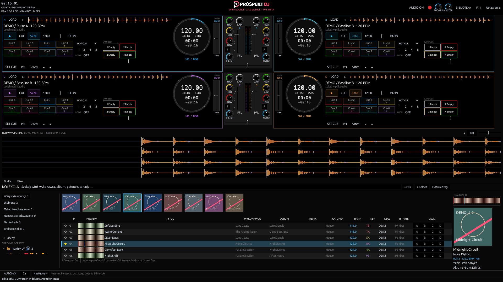
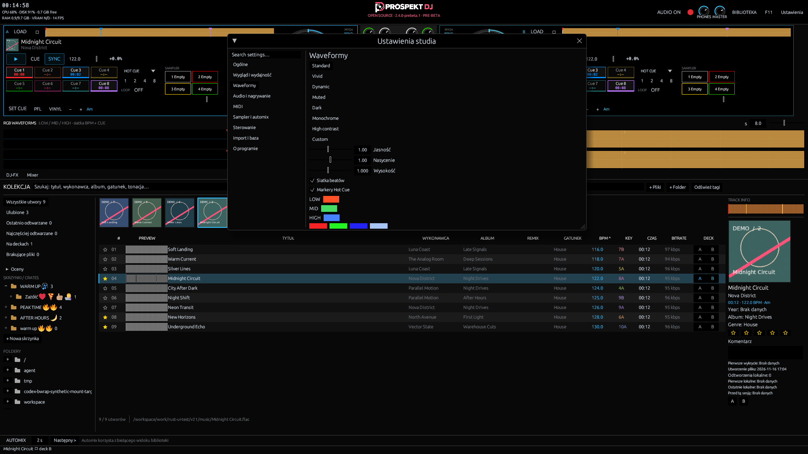

# Prospekt DJ — Rust Edition 2.4 PRE-BETA

<p align="center"></p>

[Polski](#polski) · [English](#english) · [Pobierz / Download 2.4 PRE-BETA](https://github.com/prospektdj/prospektdj/releases/tag/rust-v2.4.0-prebeta.1)

## Polski

**Prospekt DJ to prosta, otwartoźródłowa alternatywa dla VirtualDJ, Serato DJ i rekordbox, rozwijana w Rust dla Windows i Linux.** Wersja **2.4.0-prebeta.1 jest PRE-BETA**: nadaje się do testowania i zgłaszania uwag, ale nie stanowi deklaracji stabilności ani pełnej zgodności sprzętowej. Aktualizacja realizuje pierwszy etap nowego planu rozwoju; nie wszystkie jego 11 punktów są ukończone.

Własny kod aplikacji i testów jest napisany w Rust, bez Electrona, przeglądarki i Node.js. Biblioteki systemowe, dołączony SQLite i opcjonalny FFmpeg są zewnętrznymi zależnościami; SQLite zawiera kod C. Projekt jest objęty **AGPL-3.0-or-later**. Grafiki, fonty, mapowania i biblioteki zachowują odrębne licencje w [licenses](licenses). Kod aplikacji powstaje samodzielnie; OpenFadeR wykorzystano jako materiał referencyjny, bez kopiowania jego kodu aplikacji.

### Aktualne zrzuty 2.4 PRE-BETA

Poniższe zrzuty wykonano z rzeczywistej, zoptymalizowanej kompilacji Linux **2.4.0-prebeta.1**. Audio i okładki demonstracyjne są własnymi materiałami testowymi. [Daty, rozdzielczości i sumy kontrolne kompilacji/zrzutów](docs/next-update/screenshots/build-info.json). Sumy binariów z CI znajdują się osobno w `SHA256SUMS.txt` w wydaniu.






[1280×720](docs/next-update/screenshots/v24-small-1280.png) · [Cztery decki w małym oknie](docs/next-update/screenshots/v24-four-small.png) · [Skalowanie 150%](docs/next-update/screenshots/v24-dpi150.png)

### Nowości w 2.4

- **Nowy mikser:** symetryczne kolumny HIGH/MID/LOW w kolorach zielonym/złotym/czerwonym, osobny GAIN przed EQ i faderem, wspólny filtr LPF/HPF, fadery kanałów, rzeczywiste mierniki i PFL. MASTER, PHONES i czerwona ikona REC znajdują się w nagłówku. Mikser ma tło `#1A1A1A`; reszta interfejsu pozostaje ciemna.
- **Trwałe Hot Cue:** osiem slotów na nagranie zapisuje się w SQLite, wraca po restarcie i jest współdzielone między deckami z tym samym audio. Tożsamość bazuje na zdekodowanym sygnale, nie na tytule ani ścieżce. Usunięcie Cue jest zapisywane, także dla punktu w 0 sekundzie. Oryginalne pliki muzyczne nie są zmieniane.
- **Biblioteka:** kolumna PREVIEW i waveform w TRACK INFO korzystają z rzeczywistej analizy zapisywanej w cache. Dodano oceny 1–5, komentarze, dokładne filtry ocen, lokalną historię MASTER oraz widoki ostatnio/najczęściej odtwarzanych utworów. Ulubione pozostają osobnym oznaczeniem.
- **Samplery w deckach:** cztery współdzielone sloty 2×2, ładowanie pliku, wyzwalanie, czyszczenie, przechwycenie fragmentu aktywnego decka i poziom. Kliknięcie pustego slotu wybiera plik; menu pod prawym przyciskiem udostępnia pozostałe operacje. Dawna duża zakładka Samples została usunięta.
- **Sterowanie:** większe animowane PLAY/SYNC, kompaktowe Auto/Manual Loop, stan IN i powrót do zapisanej pętli po EXIT. PITCH BEND na A/C znajduje się między jogiem a mikserem i po puszczeniu wraca do zera.
- **Ustawienia i wydajność:** boczne kategorie, wyszukiwanie kategorii, skala UI, limit odświeżania, ograniczenie animacji i widoczność statystyk. Waveformy mają osiem presetów, w tym własną paletę, regulację jasności/nasycenia/wysokości oraz przełączniki siatki i markerów.
- **RAM i FPS:** rzeczywista pamięć systemowa i zmierzone tempo klatek. VRAM pokazuje `N/D`, jeśli brak obsługi odczytu sterownika.
- Zachowano 2/4 decki, jog/scratch, osiem efektów, MIDI, PFL, automix A/B, nagrywanie, skrzynki z kolorowymi emoji, drzewo folderów i okładki.

[Szczegółowy stan 11 punktów i pozostałe prace](docs/next-update/STATUS.md) · [Poprzednia aktualizacja 2.3](docs/UPDATE-2.3.md)

### Import biblioteki — obsługiwany zakres

Kreator jest dostępny po aktualizacji oraz w **Ustawienia → Import i baza**. Najpierw pokazuje podgląd, brakujące ścieżki i ograniczenia. Źródła są odczytywane bez modyfikacji. Ręczne oceny, komentarze i zajęte sloty Cue mają pierwszeństwo. Import zapisuje raport `last-import-report.json`.

| Źródło | Odczytywane dane | Ograniczenia |
|---|---|---|
| rekordbox `DJ_PLAYLISTS` XML | Metadane, BPM/czas, oceny 0–255, komentarze, daty/liczniki obecne w eksporcie, Hot Cue 0–7, playlisty | Memory Cue nie staje się Hot Cue. XML nie zawiera pełnej historii sesji. |
| VirtualDJ `database.xml` | Tags/Infos/Scan, komentarze, dostępne daty/liczniki, Cue 1–8; konwersja sekund/beat na BPM | Osobne playlisty i pliki historii nie są jeszcze importowane. |
| Mixxx SQLite | Powiązania `library.location → track_locations.id`, metadane, oceny, komentarze, dostępne liczniki/daty, skrzynki i playlisty | Odczyt spójnej transakcji z WAL. Natywne Cue i szczegółowe zdarzenia historii wymagają dalszej implementacji. |
| Serato CSV UTF-8 | Tytuł, wykonawca i inne dostępne pola historii, z jawną kolumną ścieżki pliku | Eksporty wyłącznie z tytułem są odrzucane. Natywna baza, skrzynki i markery Serato nie są jeszcze obsługiwane. |

Liczniki i daty źródłowe są zachowywane osobno; nie są bezwarunkowo sumowane z lokalnymi odtworzeniami. Nieobsługiwane lub brakujące dane nie są uzupełniane wymyśloną historią. Przeniesione dyski i konflikty ścieżek nadal mogą wymagać ręcznej naprawy. To nie jest jeszcze pełny importer wszystkich wariantów tych czterech programów.

### Pobieranie i instalacja

[Wydanie 2.4 PRE-BETA](https://github.com/prospektdj/prospektdj/releases/tag/rust-v2.4.0-prebeta.1) zawiera pięć paczek i `SHA256SUMS.txt`:

| System / format | Uruchomienie |
|---|---|
| Windows 10/11 x64 — ZIP | Rozpakuj i uruchom `prospekt-dj.exe`. Program nie jest podpisany cyfrowo. |
| Linux x64 — tar.gz | Rozpakuj i uruchom `./prospekt-dj`. |
| Debian/Ubuntu amd64 — DEB | `sudo apt install ./prospekt-dj_2.4.0-prebeta.1_amd64.deb` |
| Linux — AppImage | `chmod +x Prospekt-DJ-Rust-*.AppImage`, następnie uruchom plik. Bez FUSE użyj `APPIMAGE_EXTRACT_AND_RUN=1`. |
| Linux — Flatpak | `flatpak install --user ./Prospekt-DJ-Rust-*.flatpak`, następnie `flatpak run org.prospektdj.ProspektDJ`. Runtime pobierany jest z Flathub. |

Linux: paczki budowane na Ubuntu 22.04, glibc 2.35+, ALSA, X11/XWayland i OpenGL/Mesa. Systemowy wybór plików wymaga XDG Desktop Portal i backendu pulpitu. Flatpak udostępnia katalog Muzyka bezpośrednio, inne pliki przez portal. macOS nie jest częścią tego wydania.

Demo uruchomisz przez `prospekt-dj --demo` lub przycisk w ustawieniach. Pliki/foldery można upuszczać na okno. **WAV i AIFF są natywne**; nagrywanie do MP3/FLAC/Ogg/Opus wymaga osobnego FFmpeg w PATH, obok programu lub wskazanego przez `PROSPEKT_FFMPEG`. FFmpeg nie jest dołączany; w Flatpaku musi być dostępny wewnątrz środowiska aplikacji. Przy błędzie konwersji pozostaje plik WAV.

### Dane, prywatność i ograniczenia

- Katalog, skrzynki i ulubione są zachowywane. `tracks.sqlite` przechowuje Cue, dane użytkownika, analizę, lokalną historię i dane importu. Ścieżkę konfiguracji pokazują ustawienia. Przed ręczną kopią całego katalogu konfiguracji zamknij aplikację; nie kopiuj samej aktywnej bazy z pominięciem WAL.
- Lokalne odtworzenie jest domyślnie zaliczane po 30 sekundach na MASTER; dla krótkich utworów po połowie długości lub progu, zależnie od tego, co jest krótsze. Próg można zmienić. Samo ładowanie, analiza i PFL bez MASTER nie zwiększają licznika.
- **Pobieranie okładek jest domyślnie włączone.** MusicBrainz / Cover Art Archive otrzymuje publiczne metadane artysty, albumu, tytułu lub identyfikatory; nie otrzymuje audio ani prywatnych ścieżek. Opcję można wyłączyć. Dopasowanie jest ostrożne i może pozostawić pustą okładkę. Tagi pliku nie są zapisywane.
- SYNC jednorazowo dopasowuje tempo, bez synchronizacji fazy. Zmiana tempa zmienia wysokość dźwięku. Nie ma key lock ani STEMS. Automix używa A/B.
- PFL wymaga osobnego urządzenia systemowego. Brak rozdzielania par 1/2 i 3/4 pojedynczej karty, ASIO i bezpośredniego JACK. 334 profile MIDI nie oznaczają fizycznej certyfikacji kontrolerów; 289 zawiera rozpoznane przypisania. Nie ma pełnego wyjścia LED/HID.
- W 1280×720 cztery decki wymagają przewijania panelu; biblioteka przewija kolumny poziomo. TRACK INFO jest dostępny w szerokich oknach i przewija się pionowo.
- **Pełne tłumaczenia 24 języków UE nie są jeszcze gotowe.** Zachowano dotychczasowe dziesięć języków podstawowych kontrolek; nowe przepływy i część opisów są po polsku/angielsku. Pozostałe prace: pełniejsza historia/import, rozwiązywanie konfliktów i ścieżek, kopia/odtworzenie z UI i całkowicie asynchroniczny start bazy.
- Limity: plik utworu 100 MiB, zdekodowany PCM do 512 MiB; sample do 32 MiB i 120 s. Audio samplera i główny CUE pozostają danymi sesji; zapis Hot Cue jest trwały. Tożsamość PCM zależy od dekodera. Wielogodzinne nagrywanie i stabilność na fizycznym sprzęcie wymagają dalszych testów.

### Sterowanie i budowanie

| Skrót | Funkcja |
|---|---|
| Q/P, A/L | Play/pauza i CUE na A/B |
| Spacja, Escape | Play/pauza aktywnego decka; pauza wszystkich |
| F1–F8, Shift + pad | Hot Cue aktywnego decka; usunięcie punktu/sampla |
| 1–4 / 7–0 | Pady A/B zgodnie z trybem |
| Z/X, N/M | Chwilowy pitch bend A/B |
| Enter / Shift+Enter | Załaduj zaznaczony utwór do A/B |
| Strzałki, F11 | Wybór w bibliotece/crossfader; pełny ekran |

Mysz: przeciąganie knobów/jogów, Shift dla dokładnej regulacji, dwuklik kontrolki dla resetu. Skróty decków są wyłączane podczas wpisywania tekstu i w ustawieniach. Stare mapowanie MIDI `gain` nadal steruje faderem; nowa akcja `pre_gain` steruje osobnym GAIN.

Wymagany Rust **1.89+**, Linux: `build-essential pkg-config libasound2-dev libx11-dev`; Windows: MSVC Build Tools z Windows SDK. SQLite jest kompilowany z dołączonych źródeł zależności.

```sh
cargo fmt --all --check
cargo test --locked
cargo clippy --locked --all-targets -- -D warnings
cargo build --locked --release
```

Lokalnie przeszły **74 testy**, w tym CPAL na ALSA null i opcjonalne eksporty FFmpeg. To nie jest test fizycznego odsłuchu, MIDI, VRAM ani latencji. Workflow wydania ponownie sprawdza Linux i Windows, instaluje DEB oraz uruchamia testy startu AppImage/Flatpak. [Weryfikacja](docs/TESTS.md) · [Licencje zależności](docs/DEPENDENCIES.md) · [Pochodzenie](docs/PROVENANCE.md).

## English

**Prospekt DJ is a simple open-source alternative to VirtualDJ, Serato DJ and rekordbox, developed in Rust for Windows and Linux.** **2.4.0-prebeta.1 is PRE-BETA**: intended for testing and feedback, with no claim of stability or complete hardware compatibility. This release implements the first stage of the new development plan; not all eleven requirements are complete.

Our application and test code is Rust, with no Electron, browser or Node.js runtime. System libraries, bundled SQLite and optional FFmpeg are external dependencies; SQLite includes C code. The project is **AGPL-3.0-or-later**. Artwork, fonts, mappings and libraries retain their separate licenses in [licenses](licenses). Application code is independently developed; OpenFadeR was consulted as reference material without copying its application code.

### Current 2.4 PRE-BETA screenshots

The screenshots above are captured from the actual optimized Linux **2.4.0-prebeta.1** executable. Demo audio and covers are original test fixtures. [Capture dates, dimensions and executable/screenshot checksums](docs/next-update/screenshots/build-info.json). CI package hashes are recorded separately in the release's `SHA256SUMS.txt`.

[Two decks](docs/next-update/screenshots/v24-main-1920.png) · [Four decks](docs/next-update/screenshots/v24-four-1920.png) · [Settings](docs/next-update/screenshots/v24-settings.png) · [1280×720](docs/next-update/screenshots/v24-small-1280.png) · [Small four-deck layout](docs/next-update/screenshots/v24-four-small.png) · [150% DPI](docs/next-update/screenshots/v24-dpi150.png)

### What's new in 2.4

- **New mixer:** mirrored HIGH/MID/LOW columns with green/gold/red accents, independent pre-EQ/pre-fader GAIN, shared LPF/HPF filter, channel faders, real meters and PFL. Global MASTER, PHONES and the red REC icon move to the header. The mixer uses `#1A1A1A`; the surrounding interface remains dark.
- **Persistent Hot Cue:** eight slots per recording are stored in SQLite, restored after restart and shared across decks containing the same audio. Identity hashes decoded source audio rather than title/path. Deletions and cues at zero seconds are preserved. Original music files are not modified.
- **Library:** the PREVIEW column and TRACK INFO waveform use real cached analysis. Ratings 1–5, comments, exact rating filters, local MASTER playback history and recent/frequent views are added. Favorites remain independent.
- **Deck-local sampler:** four shared slots in a 2×2 grid, file loading, triggering, clearing, focused-deck capture and level control. Click an empty slot to choose a file; right-click for additional actions. The old large Samples tab is removed.
- **Controls:** larger animated PLAY/SYNC, compact Auto/Manual Loop, visible IN state and saved-loop re-entry after EXIT. A/C PITCH BEND sits between jog and mixer and returns to zero when released.
- **Settings/performance:** category sidebar, category search, UI scale, refresh limit, reduced motion and statistics visibility. Eight waveform presets include a custom palette, brightness/saturation/height and grid/marker switches.
- **RAM/FPS:** actual system memory and measured frame rate. VRAM displays `N/D` when driver telemetry is unavailable.
- Existing 2/4 decks, jog/scratch, eight effects, MIDI, PFL, A/B automix, recording, color-emoji crates, folder tree and artwork remain available.

[Eleven-point implementation status and remaining work](docs/next-update/STATUS.md) · [Previous 2.3 update](docs/UPDATE-2.3.md)

### Library import — supported scope

The wizard appears after updating and remains available under **Settings → Import and database**. It first previews recognized data, missing paths and limitations. Sources are read without modification. Manual ratings/comments and occupied Cue slots take priority. The import writes `last-import-report.json`.

| Source | Imported data | Limits |
|---|---|---|
| rekordbox `DJ_PLAYLISTS` XML | Metadata, BPM/duration, 0–255 ratings, comments, available dates/counts, Hot Cue 0–7 and playlists | Memory Cue is excluded from Hot Cue. Collection XML is not complete session history. |
| VirtualDJ `database.xml` | Tags/Infos/Scan, comments, available dates/counts and Cue 1–8; seconds-per-beat converted to BPM | Separate playlists and history files are not yet imported. |
| Mixxx SQLite | `library.location → track_locations.id`, metadata, ratings/comments, available counts/dates, crates and playlists | Consistent read transaction includes WAL. Native Cue and detailed history events need further implementation. |
| Serato UTF-8 CSV | Title/artist and other available history fields, with an explicit file-path column | Title-only exports are rejected. Native Serato databases, crates and markers are not yet supported. |

Source counters/dates are retained separately rather than blindly added to local plays. Unsupported or missing data is not replaced with invented history. Moved drives and path conflicts can still require manual repair. This is not a complete importer of every variant of all four applications.

### Download and installation

[2.4 PRE-BETA release](https://github.com/prospektdj/prospektdj/releases/tag/rust-v2.4.0-prebeta.1) contains five packages and `SHA256SUMS.txt`:

| Platform / package | Run or install |
|---|---|
| Windows 10/11 x64 ZIP | Extract and run `prospekt-dj.exe`. The application is unsigned. |
| Linux x64 tar.gz | Extract and run `./prospekt-dj`. |
| Debian/Ubuntu amd64 DEB | `sudo apt install ./prospekt-dj_2.4.0-prebeta.1_amd64.deb` |
| Linux AppImage | `chmod +x Prospekt-DJ-Rust-*.AppImage`, then run it. Without FUSE, use `APPIMAGE_EXTRACT_AND_RUN=1`. |
| Linux Flatpak | `flatpak install --user ./Prospekt-DJ-Rust-*.flatpak`, then `flatpak run org.prospektdj.ProspektDJ`. The runtime comes from Flathub. |

Linux packages are built on Ubuntu 22.04 and require glibc 2.35+, ALSA, X11/XWayland and OpenGL/Mesa. File selection requires XDG Desktop Portal and an appropriate desktop backend. Flatpak exposes Music directly and other files through the portal. macOS is not included in this release.

Use `prospekt-dj --demo` or the demo button in Settings. Drop music files/folders onto the window. **WAV/AIFF recording is native**; MP3/FLAC/Ogg/Opus requires a separate FFmpeg in PATH, beside the executable, or selected through `PROSPEKT_FFMPEG`. FFmpeg is not bundled and must be accessible inside the Flatpak environment when using that package. Conversion failure preserves the WAV.

### Data, privacy and limitations

- Catalog, crates and favorites are retained. `tracks.sqlite` stores Cue, user data, analysis, local history and import payloads. Settings show the configuration path. Close the application before manually copying the whole configuration directory; do not copy an active database while omitting its WAL.
- A local play normally counts after 30 seconds on MASTER; short tracks use half their duration or the threshold, whichever is shorter. The threshold is configurable. Loading, analysis and PFL-only playback do not increment it.
- **Artwork downloads are enabled by default.** MusicBrainz / Cover Art Archive receives public artist/album/title metadata or identifiers, never audio or private paths. Disable the option in Settings. Conservative matching can leave artwork blank. Music tags are not written.
- SYNC performs a one-shot tempo match without beat-phase alignment. Tempo changes also change pitch. Key lock and STEMS are not implemented. Automix uses A/B.
- PFL requires another system output device. Single-interface 1/2-versus-3/4 routing, ASIO and direct JACK are not implemented. The 334 MIDI profiles are not hardware certifications; 289 contain recognized bindings. Complete LED/HID output is unavailable.
- Four decks at 1280×720 require vertical performance scrolling; library columns scroll horizontally. TRACK INFO appears in wide windows and scrolls vertically.
- **Complete translations for all 24 EU languages are not ready.** The existing ten core-control languages remain; new workflows and some help are Polish/English. Remaining work includes fuller import/history, conflict/path resolution, UI backup/restore and fully asynchronous database bootstrap.
- Limits: source file 100 MiB, decoded PCM up to 512 MiB; sample files 32 MiB/120 s. Sampler audio and the main CUE remain session data; Hot Cue storage is persistent. PCM identity is decoder-dependent. Multi-hour recording and physical-hardware stability need further testing.

### Controls and building

| Shortcut | Action |
|---|---|
| Q/P, A/L | Play/pause and CUE on A/B |
| Space, Escape | Active-deck play/pause; pause all |
| F1–F8, Shift + pad | Focused-deck Hot Cue; delete Cue/sample |
| 1–4 / 7–0 | A/B pads according to mode |
| Z/X, N/M | Temporary A/B pitch bend |
| Enter / Shift+Enter | Load selection into A/B |
| Arrows, F11 | Library selection/crossfader; fullscreen |

Drag knobs/jogs, hold Shift for fine adjustment and double-click a control to reset it. Deck shortcuts are suppressed while typing and in Settings. Legacy MIDI `gain` still controls the channel fader; `pre_gain` controls the new independent GAIN stage.

Rust **1.89+** is required. Linux needs `build-essential pkg-config libasound2-dev libx11-dev`; Windows needs MSVC Build Tools and Windows SDK. SQLite is compiled from its bundled dependency sources.

```sh
cargo fmt --all --check
cargo test --locked
cargo clippy --locked --all-targets -- -D warnings
cargo build --locked --release
```

**74 local tests passed**, including CPAL through ALSA null and optional FFmpeg exports. This is not physical headphone/MIDI/VRAM/latency verification. Release CI checks Linux/Windows again, installs the DEB and runs AppImage/Flatpak startup smoke tests. [Validation](docs/TESTS.md) · [Dependency licenses](docs/DEPENDENCIES.md) · [Provenance](docs/PROVENANCE.md).

Application modules: `ui.rs`/`widgets.rs` (native interface), `engine.rs`/`audio.rs`/`dsp.rs`/`effects.rs` (audio), `media.rs` (decoding/analysis), `track_store.rs`/`library_data.rs`/`dj_import.rs` (persistent data and imports), `library.rs`/`folder_tree.rs` (catalog/tree), `artwork.rs`/`emoji.rs` (graphics), `midi.rs`/`controller_import.rs` (controllers), `recording.rs`, `settings.rs`, `wave_style.rs`, `telemetry.rs` and `i18n.rs`.
