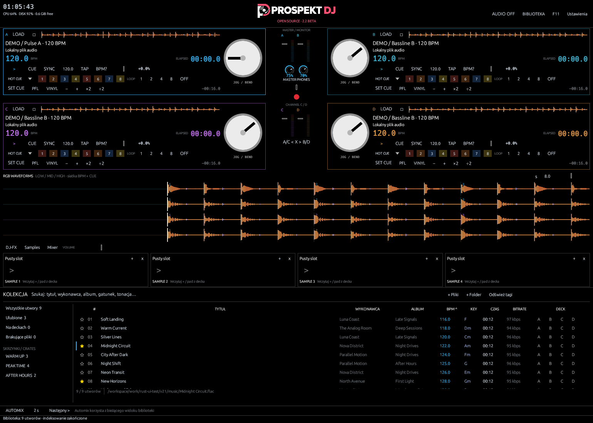
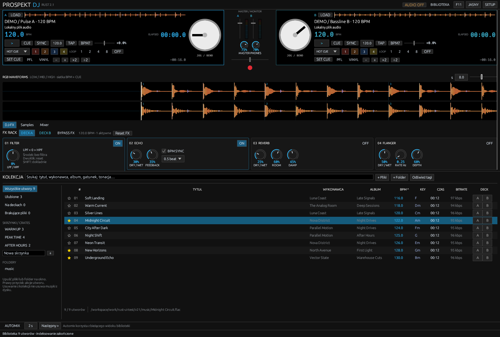
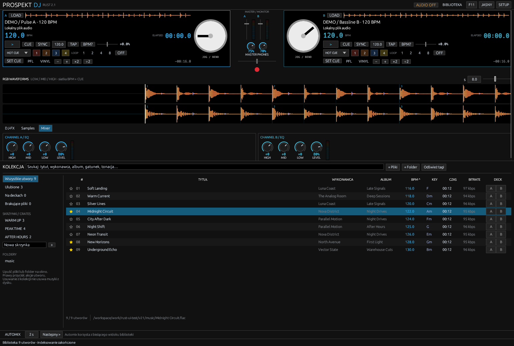

# Prospekt DJ — Rust Edition 2.1

**100% własnego kodu aplikacji i testów jest w Rust.** Nie jest to deklaracja, że wszystkie sterowniki systemowe i zewnętrzne kodeki są napisane w Rust. Biblioteki systemowe audio/okien oraz opcjonalny FFmpeg pozostają zewnętrznymi zależnościami.

Licencja projektu: **GPL-3.0-or-later**. Źródła, Cargo.lock i instrukcje budowania znajdują się w paczce źródłowej. Licencje bibliotek są w `licenses/`, a ich lista w `docs/DEPENDENCIES.md`.

## Zrzuty ekranu

Zrzuty natywnej aplikacji na Linuxie, z utworami demonstracyjnymi i przykładową biblioteką.

**Widok główny — dwa decki, fale RGB, sampler i biblioteka utworów.**



**DJ-FX — filtr LPF/HPF, echo z synchronizacją BPM, reverb i flanger.**



**Mixer — korekcja HIGH/MID/LOW i poziomy obu kanałów.**



## Zmiany w 2.1

- Kompaktowe decki, białe talerze, dwie fale RGB z pasmami rzeczywistego sygnału i zakładki DJ-FX / Samples / Mixer. W wąskim oknie talerze ustępują miejsca kontrolkom.
- Cztery efekty na deck: filtr LPF/HPF, echo z synchronizacją BPM, reverb i flanger; bypass i sterowanie MIDI.
- Proste pokrętła z resetem podwójnym kliknięciem i cienkie suwaki. Wyśrodkowany panel master/monitor; czerwona ikona nagrywania pod crossfaderem, kwadrat zatrzymania podczas nagrywania.
- Biblioteka z indeksowaniem w tle, pamięcią metadanych, skrzynkami, sortowaniem, wyszukiwaniem wielu słów i naprawą ścieżek brakujących plików. Usunięcie z katalogu nie usuwa pliku z dysku.

## Gotowe paczki

Paczki Windows x64 (ZIP), Linux x64 (tar.gz) i Debian/Ubuntu amd64 (.deb) są publikowane w [GitHub Releases](https://github.com/prospektdj/prospektdj/releases). Sumy kontrolne są w SHA256SUMS.txt. Workflow buduje Windows i Linux, sprawdza archiwa i publikuje trzy paczki po zakończeniu obu zadań.

Instalacja DEB na Ubuntu 22.04+ lub Debian 12+: `sudo apt install ./prospekt-dj_2.1.0_amd64.deb`. Program pojawi się w menu aplikacji; można też uruchomić `prospekt-dj` w terminalu. Usunięcie: `sudo apt remove prospekt-dj`. Ustawienia w katalogu użytkownika pozostają zachowane. FFmpeg jest zalecany dla dodatkowych formatów nagrywania.

## Uruchamianie

Windows 10/11 x64: rozpakuj archiwum i uruchom `prospekt-dj.exe`. Nie wymaga Node.js, przeglądarki ani instalowania Rusta. Program nie jest podpisany cyfrowo.

Linux x64 z pulpitem: paczki z GitHub Releases są budowane na Ubuntu 22.04 i wymagają glibc 2.35+ (np. Ubuntu 22.04+ lub Debian 12+). Rozpakuj archiwum i uruchom `./prospekt-dj`. Wymagane są ALSA, X11/XWayland i sterownik OpenGL 3.3 lub zgodny Mesa. Systemowy wybór plików używa XDG Desktop Portal. Na Debianie/Ubuntu potrzebne biblioteki zwykle zapewniają pakiety `libasound2` (w nowszych wydaniach `libasound2t64`), `libx11-6`, `libxkbcommon0`, `libgl1`, `xdg-desktop-portal` i backend portalu odpowiedni dla pulpitu.

Naciśnij **Demo 120 BPM**, następnie uruchom deck A/B. Parametr `--demo` wczytuje demo przy starcie. Pliki lub folder można przeciągać na okno; przy utworze przyciski A/B ładują odpowiedni deck.

Gdy brak działającego urządzenia audio, program wyświetla ten stan i pozwala wybrać inne wyjście w ustawieniach. Nie symuluje wówczas dźwięku. Zastosowanie nowego wyjścia wymaga pauzy decków i zakończenia nagrywania; utwory, punkty i sample pozostają w sesji.

## Funkcje

- Dwa decki, odtwarzanie i pauza, przewijanie, aktualny/pozostały czas, waveform ogólny i przewijany z zoomem.
- Dekodowanie MP3, WAV, FLAC, Vorbis/OGG, AAC/M4A, ALAC i AIFF przez Symphonia. Nierozpoznany kodek, m.in. Opus, może skorzystać z FFmpeg. Obsługa metadanych i okładek przez Lofty.
- Tempo 50–150%, TAP, analiza BPM w tle, ręczne BPM, ×2/÷2, SYNC tempa i chwilowy pitch bend.
- Jog myszą i MIDI, scratch w obu kierunkach, CUE, cztery hot cue na deck, pętle 1/2/4/8 beatów i manual IN/OUT.
- Trzypasmowy EQ, głośności kanałów/master, crossfader stałej mocy, limiter i wskaźnik sygnału.
- Cztery współdzielone sample: plik lub fragment decka, odtwarzanie bez załadowanego decka, usuwanie i głośność.
- Biblioteka plików i folderów, wyszukiwanie, załadowane utwory, ulubione i obsługa upuszczania plików. Biblioteka jest teraz zachowywana między sesjami.
- Automix z przygotowaniem następnego utworu w tle, przejściem liczonym według próbek audio, wyborem ulubionych, losowaniem, powtarzaniem i dwiema krzywymi. Ręczny transport zatrzymuje automat.
- Natywne MIDI przez midir: Learn, Note/CC, kontrolki absolutne, trzy kodowania względnych enkoderów, import/eksport map JSON. Importuje także mapy poprzedniej wersji HTML.
- Osobne urządzenie MASTER i odsłuch PFL, niezależna głośność słuchawek i dopasowanie częstotliwości próbkowania osobnych wyjść.
- Zapis miksu po limiterze: WAV, AIFF, MP3, FLAC, OGG/Opus i OPUS. Dane płyną na dysk z osobnego wątku; nagranie nie jest przechowywane w całości w RAM.
- Jasny/ciemny motyw, pełny ekran, widok biblioteki, skróty i ustawienia. Zamknięcie podczas nagrywania pozwala najpierw dokończyć zapis.

## Nagrywanie i FFmpeg

**WAV i AIFF działają bez FFmpeg** — zapis realizuje kod Rust. Do MP3, FLAC i Ogg/Opus doinstaluj FFmpeg lub umieść `ffmpeg.exe` / `ffmpeg` obok programu. Można też wskazać plik przez `PROSPEKT_FFMPEG`. FFmpeg nie jest dołączany do paczek.

Przed nagrywaniem wybierz format. Kliknij „Nagraj miks”, wskaż docelowy plik, a po zakończeniu kliknij Stop i zaczekaj na potwierdzenie. Konwersja działa w tle. Przy błędzie dodatkowego kodeka pozostaje plik `*.recording.wav`; komunikat podaje jego lokalizację. Przy przeciążeniu kolejki zapisu nagrywanie zostaje przerwane, a WAV zachowany — nie pomijamy niezauważenie fragmentów nagrania.

## Sterowanie

| Klawisz | Funkcja |
|---|---|
| Q / P | Play/pauza decka A / B |
| A / L | Powrót do CUE A / B |
| Spacja | Play/pauza aktywnego decka |
| Escape | Pauza obu |
| ← / → | Crossfader |
| Z / X, N / M | Pitch bend A / B |
| 1–4, 7–0 | Pady A / B |
| Shift + pad | Usuń hot cue / sample |
| Enter / Shift+Enter | Załaduj wybrany utwór do A / B |
| ↑ / ↓ | Wybór w bibliotece |
| F11 | Pełny ekran |

W trybie manual loop pady oznaczają: 1 IN, 2 OUT, 3 OFF, 4 powrót. Mysz: talerz przeciąga się poziomo; dwuklik suwaka EQ lub tempa resetuje wartość. Skróty decków nie działają podczas wpisywania tekstu i w oknie ustawień.

## Budowanie

Potrzebny jest Rust **1.89+**; build wykonano toolchainem 1.100.0. Na Linux potrzebne są również `build-essential`, `pkg-config`, `libasound2-dev` i `libx11-dev`. Na Windows zalecany jest target MSVC i Microsoft C++ Build Tools z Windows SDK.

```sh
cargo build --locked --release
cargo test --locked
cargo clippy --all-targets -- -D warnings
```

Plik wykonywalny: `target/release/prospekt-dj` albo `target/release/prospekt-dj.exe`. Dla kompilacji skrośnej Windows można użyć targetu `x86_64-pc-windows-gnu` i MinGW-w64. Workflow `.github/workflows/build.yml` buduje program natywnie na Windows i Linux oraz udostępnia artefakty workflow. Nie publikuje automatycznie wydania ani repozytorium.

Dodatkowe testy wymagają jawnego wskazania środowiska:

```sh
PROSPEKT_TEST_FFMPEG=1 cargo test --test core
PROSPEKT_TEST_AUDIO=1 cargo test --test audio_backend
```

Test audio otwiera rzeczywiste domyślne urządzenie CPAL. W środowisku budującym użyto testowego urządzenia ALSA null. Szczegóły i ograniczenia potwierdzeń: `docs/TESTS.md`.

## Granice wersji

SYNC dopasowuje tempo bez wyrównania fazy bitów. Zmiana tempa zmienia również wysokość dźwięku. Nie dodano STEMS ani czterech decków z projektu wzorcowego, bo nie były funkcjami dostarczonego HTML.

Osobny odsłuch wymaga drugiego urządzenia udostępnionego przez system. Nie zaimplementowano rozdzielania kanałów 1/2 i 3/4 pojedynczego interfejsu, ASIO ani bezpośredniego JACK. Brak fabrycznej, sprzętowo zweryfikowanej mapy DJ2GO2 i sterowania diodami. Połączenie MIDI jest monitorowane co dwie sekundy i automatycznie odnawiane po ponownym podłączeniu urządzenia o tej samej nazwie. Dostępne jest również ręczne odświeżenie i ponowne połączenie.

Utwór wejściowy: do 100 MiB; zdekodowane PCM: do 512 MiB. Sample: plik do 32 MiB i czas do 120 sekund. CUE i sample pozostają danymi sesji. WAV ma ograniczenia rozmiaru kontenera RIFF; nie przeprowadzono wielogodzinnego testu nagrywania. Nadmiernie duże pliki oraz nieobsługiwane kodeki zwracają błąd w pasku stanu.

Paczki z GitHub Releases są kompilowane i testowane automatycznie na runnerach Windows i Linux. Instalacja pakietu .deb jest sprawdzana na Ubuntu. Sprzęt MIDI, fizyczny odsłuch i opóźnienie wymagają sprawdzenia na komputerze docelowym.

## Pliki projektu

`src/ui.rs` — natywne okno i przepływy pracy; `engine.rs` — decki, sample, pętle i przejścia; `audio.rs` — urządzenia CPAL i odsłuch; `dsp.rs` — EQ/crossfader; `media.rs` — dekodowanie, metadane, BPM; `midi.rs` — kontrolery i mapy; `recording.rs` — zapis i eksport; `settings.rs` — ustawienia lokalne. W projekcie nie ma własnych źródeł JS/TS/HTML/CSS/C/C++.
