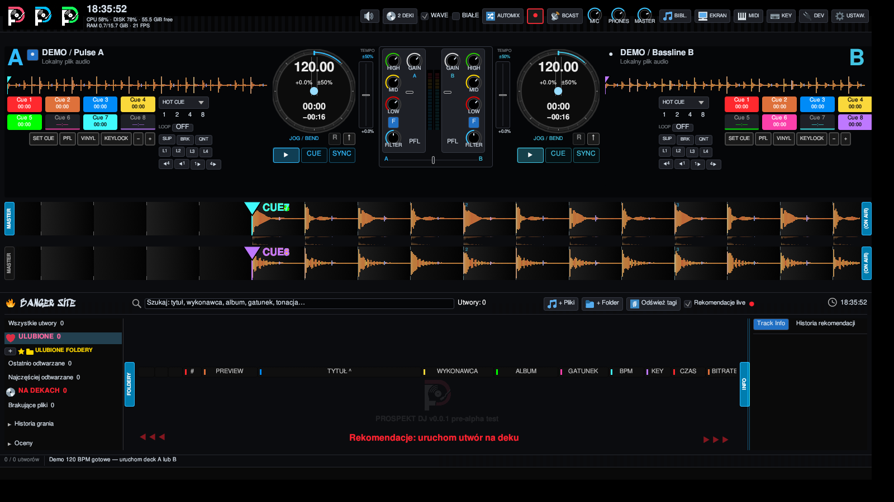
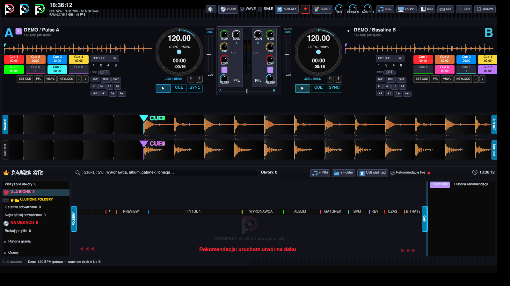
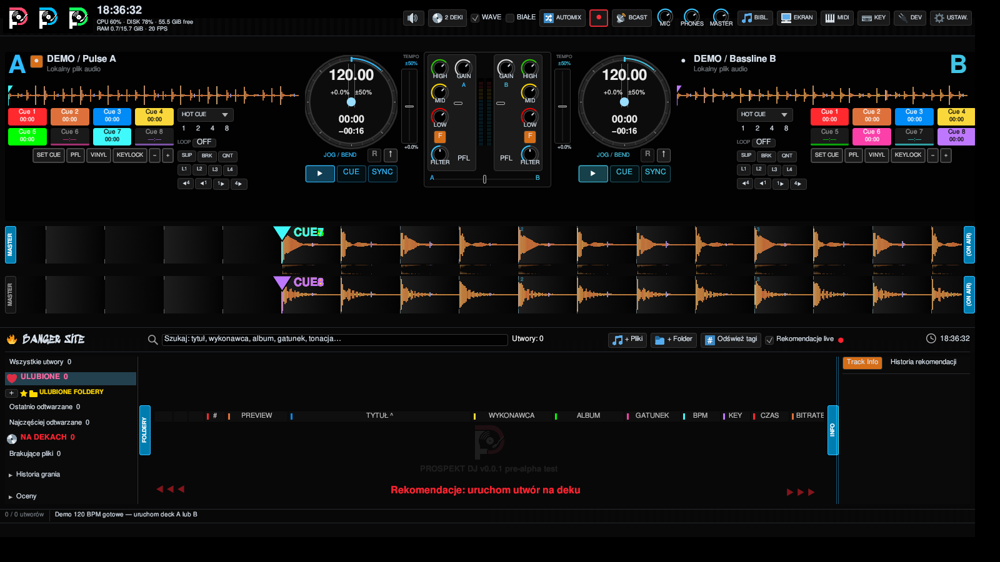
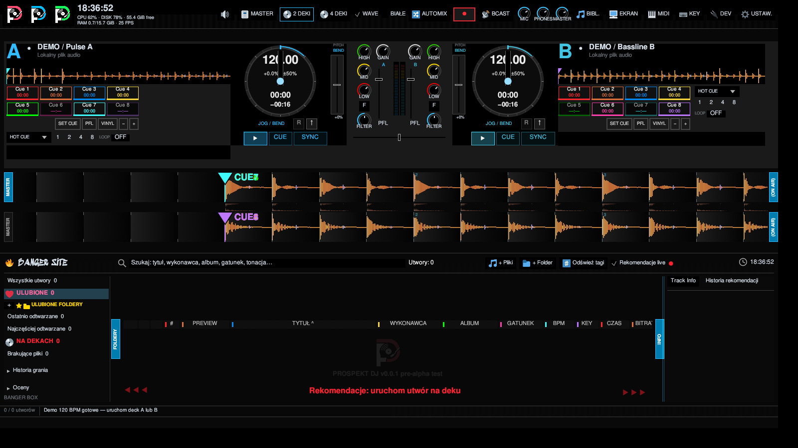
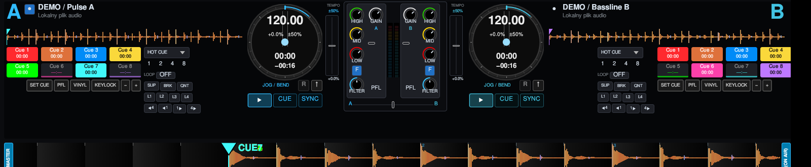

# Prospekt DJ — pre-alpha 0.0.1 test

## 🇵🇱 Polski

Natywny, otwartoźródłowy program DJ dla Windows i Linux. Własny kod Rust/egui, bez Electrona. [Wydania i paczki](https://github.com/prospektdj/prospektdj/releases) · [Dokumentacja](docs/INDEX.md) · [Licencje](docs/DEPENDENCIES.md).

### 🖼️ Zrzuty ekranów

| Skórka nowoczesna (domyślna) | Dracula |
| --- | --- |
|  |  |
| **Carbon** | **Oryginalna (czarna)** |
|  |  |

Szczegół deków w skórce nowoczesnej (SLIP / BRK / QNT, pętle L1–L4, skoki o takty, suwak TEMPO):

### 🎛️ Funkcje

- **Dwa lub cztery deki** z powiększonymi jogami, animowaną wskazówką, pitch bend, PLAY/CUE/SYNC i pierścieniem postępu utworu (skórki nowoczesne).
- **Suwak TEMPO** w skórkach nowoczesnych: stałe tempo z zakresem ±6 %, ±10 %, ±16 % lub ±50 % (ustawienia → Mikser i deki). Chwilowy bend zostaje na przyciskach − / +.
- **KEYLOCK**: zmiana tempa bez zmiany tonacji (przesuwnik wysokości w czasie rzeczywistym). Jakość jest prostsza niż w profesjonalnych algorytmach typu phase vocoder.
- **SYNC**: dopasowuje tempo i fazę bitów do drugiego deku. Wybiera połowę lub podwójne tempo, jeśli to bliżej 0 % suwaka.
- **Nowe funkcje pracy z deskami** w skórkach nowoczesnych: **SLIP** (utwór gra pod pętlami i skokami), **BRK** (hamowanie jak gramofon), **QNT** (punkty Hot Cue na siatce bitów), **sloty pętli L1–L4** (Shift+klik zapisuje pętlę) oraz **skoki o takty** ◀4 ◀1 1▶ 4▶.
- Menu HOT CUE / AUTO LOOP / MANUAL LOOP / SAMPLER / EFFECTS na każdym deku. Osiem punktów CUE i osiem efektów: Filter, Echo, Reverb, Flanger, Chorus, Tremolo, Distortion, Bitcrusher.
- **Mikser**: kanały na kartach, EQ, gain, PFL, miernik poziomu i suwak krzyżowy z literami A/B. Krzywa suwaka (Smooth / Sharp / Const) i możliwość jego wyłączenia (obie strony otwarte) w ustawieniach.
- **Osiem skórek nowoczesnych plus oryginał**: Nowoczesna, Dracula, Nord, Gruvbox Dark, Tokyo Night, Carbon, Midnight, Neon oraz Oryginalna (czarna, z oryginalnym układem). Szczegóły w [docs/SKINS.md](docs/SKINS.md).
- Główne waveformy z siatką rytmu, dużymi flagami CUE, przybliżaniem kółkiem myszy i odbiciami między kanałami.
- BANGER SITE / Kolekcja, BANGER BOX, ulubione utwory i foldery, kolory folderów, SAMPLER, foldery systemowe, dyski i powiadomienia o nośnikach.
- Okładki, animacje, menu ładowania A–D, przeciąganie prawym przyciskiem oraz okno metadanych po 6,66 s.
- TRACK INFO: tonacja w kolorze, komentarze z emoji, osiem pól CUE, odsłuch poza dekami przez PHONES.
- Lokalne rekomendacje BPM/tonacja/gatunek, odstęp 1–3600 s (domyślnie 60 s), historia odtworzeń w datowanych sesjach.
- AutoMix A/B, nagrywanie miksu, mikrofon, streaming Icecast i Shoutcast v1 przez zewnętrzny FFmpeg. Przyciski BCAST, MIDI LEARN, KEY, DEV i USTAWIENIA na górnym pasku.
- Dwa kontrolery MIDI z osobnymi mapowaniami i wykrywaniem portów. Katalog 334 profili nie zastępuje testu konkretnego sprzętu.
- Kopiowanie, przenoszenie, zmiana nazw, podfoldery, odświeżanie tagów i okładek. Integracja Google Drive tylko do odczytu, z własnym klientem OAuth Desktop.
- Windows: WASAPI, ASIO i wykrywanie ASIO4ALL. Linux: ALSA z mostem PulseAudio/PipeWire.
- Dane aplikacji przenośnej są obok pliku wykonywalnego; komentarze i CUE w SQLite.

### 🚧 Jeszcze nie ma

Stemy (separacja ścieżek), pełny Beat Lab, workspace EDIT, eksport na pendrive dla odtwarzaczy DJ, adaptery bibliotek zewnętrznych, Key Sync, oświetlenie i wideo, edytor skrótów klawiszowych, układy Stage i Pocket.

### 🚀 Uruchomienie

Rozpakuj paczkę do zapisywalnego folderu i uruchom `prospekt-dj.exe` lub `./prospekt-dj`. Nie przenoś samego pliku wykonywalnego bez danych programu. Linux wymaga ALSA, X11/OpenGL i systemowych usług audio; w kontenerze Chromebooka potrzebny jest działający most audio i pakiet `libasound2-plugins`. Opcjonalny FFmpeg jest potrzebny do nagrywania MP3 i transmisji. Nie instaluje się sterowników automatycznie.

### 🧪 Status i budowanie

To **pre-alpha 0.0.1 test**, przeznaczone do prób. Key lock jest eksperymentalny i może dawać artefakty przy dużych zmianach tempa. SYNC dopasowuje fazę bitów na podstawie wykrytej siatki, więc przy słabo rozpoznanym tempie może być nieprecyzyjny. AutoMix używa A/B. Modele urządzeń wynikają z portów/profili, a nie certyfikacji USB. Linuxowe testy mostu korzystają z symulowanego PCM; Chromebook, sterowniki ASIO/Realtek, kontrolery i nośniki wymagają testów fizycznych. Pełne tłumaczenie wszystkich ekranów na wszystkie języki nie jest ukończone.

Rust ≥1.89, `cargo build --locked --release`, testy: `cargo test --locked`. [Platformy i testy](docs/BUILD.md), [Sterowanie i nowe funkcje](docs/CONTROLS.md), [Skórki](docs/SKINS.md), [Dane przenośne](docs/PORTABLE-DATA.md), [audio Chromebook](docs/CHROMEBOOK-AUDIO.md), [ASIO4ALL](docs/ASIO4ALL.md). Kod aplikacji: AGPL-3.0-or-later ([LICENSE](LICENSE)); oddzielne licencje bibliotek, mapowań, fontów i grafik zachowano w `licenses/`.

## 🇬🇧 English

Native open-source DJ application for Windows and Linux. Original Rust/egui code, without Electron. [Releases and packages](https://github.com/prospektdj/prospektdj/releases) · [Documentation](docs/INDEX.md) · [Licenses](docs/DEPENDENCIES.md).

### 🖼️ Screenshots

| Modern skin (default) | Dracula |
| --- | --- |
|  |  |
| **Carbon** | **Original (black)** |
|  |  |

Deck close-up in the modern skin (SLIP / BRK / QNT, loop slots L1–L4, beat jumps, TEMPO fader):

### 🎛️ Features

- **Two or four decks** with enlarged jogs, rotating hand, pitch bend, PLAY/CUE/SYNC and a track progress ring (modern skins).
- **TEMPO fader** in the modern skins: a persistent tempo with a selectable range of ±6 %, ±10 %, ±16 % or ±50 % (Settings → Mixer and decks). Momentary bend stays on the − / + buttons.
- **KEYLOCK**: change tempo without changing key, using a real-time delay-line pitch shifter. Quality is simpler than professional phase-vocoder algorithms.
- **SYNC** matches tempo and beat phase to the other deck. It picks half or double tempo when that is closer to 0 % on the fader.
- **New deck tools** in the modern skins: **SLIP** (the track keeps playing under loops and jumps), **BRK** (brake like a turntable), **QNT** (hot cues snap to the beat grid), **loop slots L1–L4** (Shift+click saves a loop) and **beat jumps** ◀4 ◀1 1▶ 4▶.
- HOT CUE / AUTO LOOP / MANUAL LOOP / SAMPLER / EFFECTS menu on each deck. Eight hot cues and eight effects: Filter, Echo, Reverb, Flanger, Chorus, Tremolo, Distortion, Bitcrusher.
- **Mixer**: channel cards with EQ, gain, PFL, level meter and an A/B crossfader. Crossfader curve (Smooth / Sharp / Const) and an on/off switch (both sides open) in Settings.
- **Eight modern skins plus the original**: Modern, Dracula, Nord, Gruvbox Dark, Tokyo Night, Carbon, Midnight, Neon and Original (black, original layout). See [docs/SKINS.md](docs/SKINS.md).
- Main waveforms with beat grid, large cue flags, wheel zoom and reflections between channels.
- BANGER SITE / Collection, BANGER BOX, favorite tracks and folders, folder colors, SAMPLER, system folders, disks and mounted-media notifications.
- Artwork, animations, A–D loading menus, right-button drag and a metadata popup after 6.66 seconds.
- TRACK INFO: colored musical key, emoji comments, eight cue fields, off-deck headphone preview.
- Local BPM/key/genre recommendations, 1–3600-second interval (default 60 s), dated playback-history sessions.
- A/B AutoMix, mix recording, microphone, Icecast and Shoutcast v1 broadcasting through external FFmpeg. BCAST, MIDI LEARN, KEY, DEV and SETTINGS in the header.
- Two MIDI controllers with independent mapping banks and port discovery. The 334-profile catalog does not establish physical hardware certification.
- Copy, move, rename, subfolders, tag and artwork refresh. Read-only Google Drive integration requires your own Desktop OAuth client.
- Windows: WASAPI, ASIO and discovery of ASIO4ALL. Linux: ALSA with PulseAudio/PipeWire bridge.
- Portable application data stays beside the executable; comments and cues use SQLite.

### 🚧 Not yet available

Stems (source separation), the full Beat Lab, the EDIT workspace, USB export for DJ players, external library adapters, Key Sync, lighting and video, a keyboard-shortcut editor, and the Stage and Pocket layouts.

### 🚀 Run

Extract into a writable directory and run `prospekt-dj.exe` or `./prospekt-dj`. Keep the application data with the executable. Linux requires ALSA, X11/OpenGL and system audio services; Chromebook containers need a working audio bridge and `libasound2-plugins`. Optional external FFmpeg enables MP3 recording and broadcasting. Hardware drivers are never installed automatically.

### 🧪 Status and build

This is **pre-alpha 0.0.1 test**, intended for testing. Key lock is experimental and can produce artifacts at large tempo changes. SYNC aligns beat phase from the detected grid, so it can be imprecise when the tempo is poorly detected. AutoMix uses A/B. Device models come from ports/profiles, not USB certification. Linux bridge tests use a simulated PCM; Chromebook, ASIO/Realtek, controllers and storage require physical testing. Complete localization of every screen into every language is unfinished.

Rust ≥1.89, `cargo build --locked --release`, tests: `cargo test --locked`. See [platforms and testing](docs/BUILD.md), [controls and new features](docs/CONTROLS.md), [skins](docs/SKINS.md), [portable data](docs/PORTABLE-DATA.md), [Chromebook audio](docs/CHROMEBOOK-AUDIO.md) and [ASIO4ALL](docs/ASIO4ALL.md). Application code: AGPL-3.0-or-later ([LICENSE](LICENSE)); separate dependency, mapping, font and artwork notices remain in `licenses/`.
