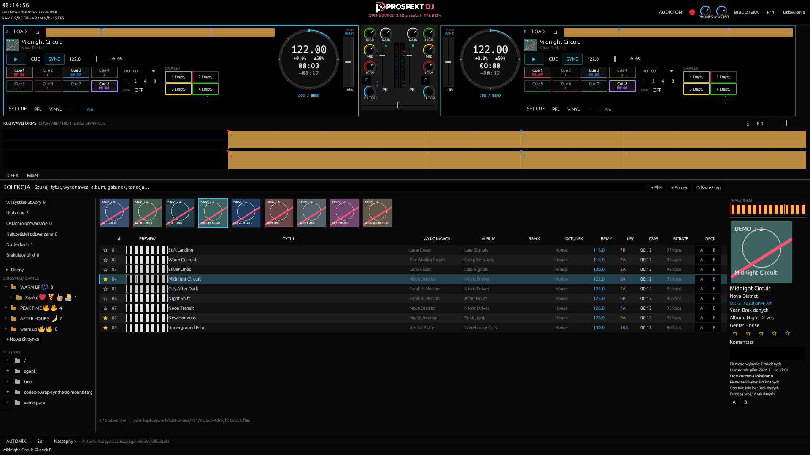
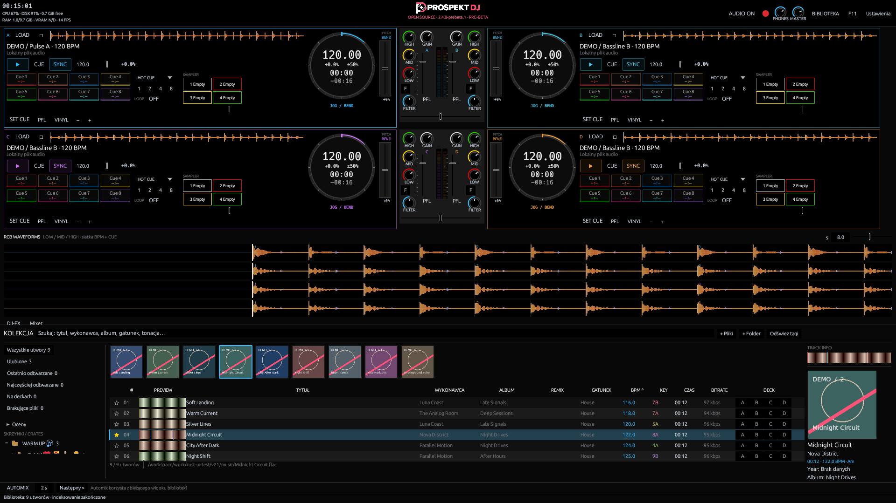

# Prospekt DJ Rust {{VERSION}} — PRE-BETA

**PRE-BETA / early test release.** Pierwszy etap aktualizacji 2.4; cały plan 11 punktów nie jest jeszcze ukończony. / First stage of the 2.4 update; the full eleven-point plan remains in progress.

## Zmiany / Changes

- New mirrored A/B and C/D mixer: colored EQ, independent smoothed pre-EQ GAIN, shared filter, channel faders/PFL/meters and crossfader. MASTER/PHONES/REC move to the header.
- Persistent SQLite Hot Cue banks shared by exact audio identity across decks/restarts. Ratings/comments, real cached waveform PREVIEW, local MASTER-time history and exact rating filters.
- Compact deck-local shared sampler, improved loops, larger animated PLAY/SYNC, inward A/C pitch bend.
- Category settings, eight waveform palettes/custom colors, UI scale/refresh/reduced motion, actual RAM and measured FPS; unsupported VRAM shows N/D.
- Read-only import wizard: rekordbox collection XML, VirtualDJ database XML, Mixxx SQLite and Serato UTF-8 history CSV **with explicit paths**. Scope and limitations are listed in the README and import report. Native Serato crates/databases, full history-event import and Mixxx native Cue are not complete.

## Pobieranie / Downloads

- **Windows x64 ZIP:** extract and run `prospekt-dj.exe` (unsigned).
- **Linux x64 tar.gz:** extract and run `./prospekt-dj`.
- **Debian/Ubuntu amd64 DEB:** `sudo apt install ./prospekt-dj_{{VERSION}}_amd64.deb`.
- **AppImage:** make executable and run; without FUSE, use `APPIMAGE_EXTRACT_AND_RUN=1`.
- **Flatpak:** `flatpak install --user ./Prospekt-DJ-Rust-*.flatpak`; run `flatpak run org.prospektdj.ProspektDJ`. Runtime comes from Flathub.

Linux packages target Ubuntu 22.04+ / glibc 2.35+ with a desktop, ALSA and OpenGL/Mesa. macOS is not included. WAV/AIFF are native; other recording codecs require separately installed FFmpeg, accessible inside Flatpak when using that package.

`SHA256SUMS.txt` covers the five packages, six native screenshots and screenshot build metadata. The locally captured screenshot executable has its own hash; it is not claimed to be byte-identical to CI-built packages.

## Weryfikacja i ograniczenia / Verification and limitations

74 local tests passed with CPAL ALSA-null and FFmpeg opt-ins, fmt, Clippy and Linux Release compilation. Release CI separately builds/tests Windows and Linux, verifies Debian installation and AppImage/Flatpak startup before this publication. This is not physical MIDI/headphone/VRAM/latency certification.

**All 24 EU translations are not yet implemented.** Import/history/conflict resolution and database backup/restore UI remain incomplete. At 1280×720 four decks require vertical scrolling. SYNC is tempo-only; no key lock/STEMS/ASIO/direct JACK or single-interface channel-pair PFL routing. Read the [complete implementation status](https://github.com/prospektdj/prospektdj/blob/{{TAG}}/docs/next-update/STATUS.md) before relying on unfinished workflows.

Open source **AGPL-3.0-or-later**, original Rust application logic with separately licensed dependencies, mappings and graphics. Proprietary Helvetica is not bundled. Artwork lookup is enabled by default and sends public metadata to MusicBrainz/Cover Art Archive, not audio or private paths; disable it in Settings if desired.
